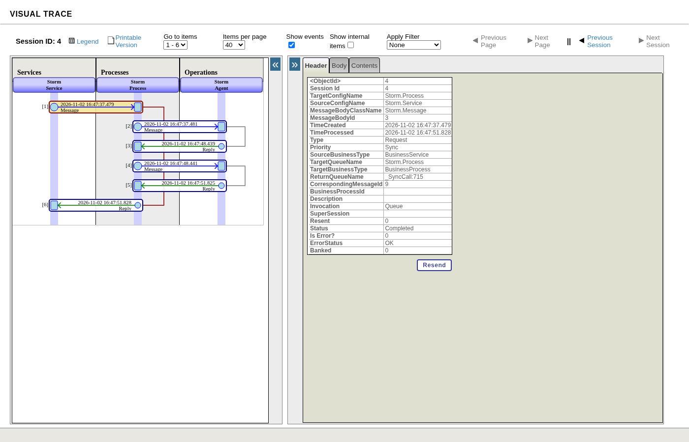
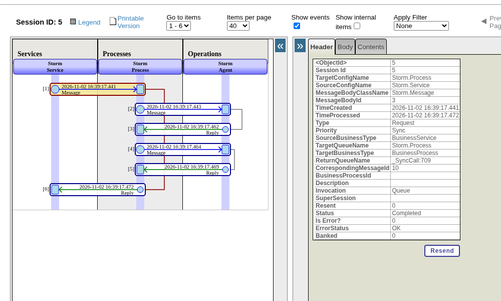
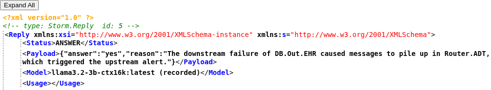
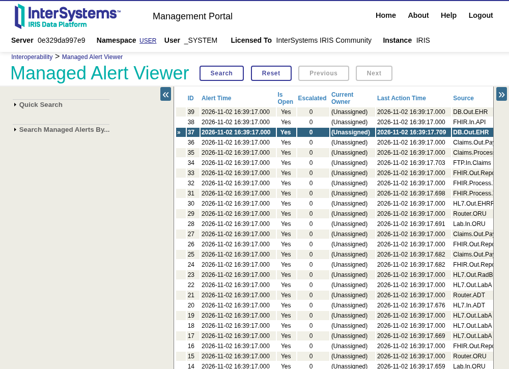
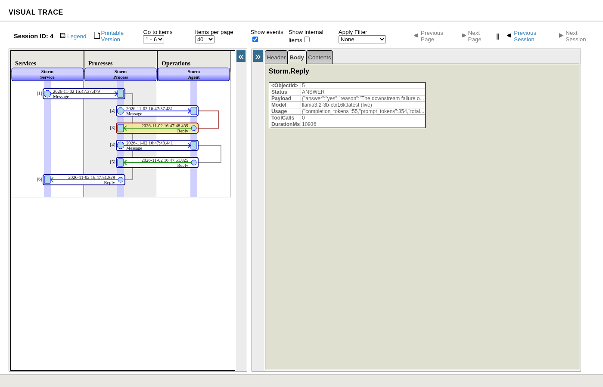

# Storm Link

## For judges: 2 minutes

**They fix one failed message; we find the one cause behind the whole storm.**

When one interface fails, every component downstream raises its own alert. Storm Link uses a versioned Production topology graph, folds the storm into one root cause on a native Managed Alert, and asks a small model only the yes/no questions the graph cannot settle.

**1. Watch the demo video:** https://youtu.be/N950ADnIfTc (MP4 download, no sign-in: [storm-link-demo.mp4](https://github.com/inunanba/storm-link/releases/download/media-v1/storm-link-demo.mp4))

**2. See the results.**

| Storms solved exactly | Graph rule | Graph + AI |
|---|---:|---:|
| Development set (14) | 10/14 | **14/14** |
| Second set (15) | 6/15 | **11/15** |
| Ambiguous storms, both sets (18) | 5/18 | **14/18** |

Adding the AI step raised the ambiguous storms solved from 5 to 14 out of 18, and graph + AI solved all 14 storms in the development set. On the second set of 15 new cases, graph + AI reached 11/15.

**3. Run it in two commands** (after the one-time image load in [Quick start](#quick-start)):

```sh
docker compose up -d --build     # IRIS + worker, healthy in about 15 s once the image is loaded
./scripts/demo.sh                # replay two storms + run all native tests
```

The script folds two storms into their root causes and runs the native IRIS `%UnitTest` suite: 12 test methods and 72 assertions, all passing. Replay mode needs no API key and no model download.

**4. Open the result where on-call already looks.**

- **Managed Alerts** → alert 4: the root cause `DB.Out.EHR` for storm A1, with the AI evidence written as an action reason.
- **Visual Trace** (link printed by the script): the whole storm as one session, Service → Process → WorkerOp → Process, and the Agent step with the model, tool calls and duration.

In live mode, the Llama 3.2 3B model answered both yes/no questions for storm A1 and all three alerts landed under `DB.Out.EHR` ([live trace export](docs/trace-A1-C01-live.txt)). Full walkthrough: [Root cause in two minutes](#root-cause-in-two-minutes).

## What it does

1. **Groups by topology.** A versioned graph of the Production joins alerts from different components that share an upstream path, and picks the upstream root.
2. **Asks only when unsure.** A detector spots root conflicts and possible coincidences; `%AI.Agent` answers one yes/no question per conflict. Code checks every answer against the candidates and the exact partition.
3. **Writes to the place on-call already looks.** All original alerts become `Ens.Alerting.ManagedAlert` records; the root alert carries the AI evidence as an action reason, and the receipt is written in the same transaction.
4. **Traceable end to end.** Each storm is one Visual Trace session: Service → Process → WorkerOp → Process, and Agent when the graph asks a question. The agent step shows the model, tool calls and duration.
5. **Idempotent.** Resubmitting a storm ID returns the saved receipt with zero new alerts and zero new agent calls.

## Community Idea implemented

[DPI-I-689](https://ideas.intersystems.com/ideas/DPI-I-689): Use InterSystems Interoperability as a Traceability tool for GenAI LLM pipelines (status: Community Opportunity).

Storm Link uses Visual Trace as the trace for every LLM call in the storm production:

1. **What we needed.** When the production asks the model a yes/no question, that call should appear in the same Visual Trace session as the storm, with the model name, token counts and how long it took — without a separate tracing service.
2. **What we built.** Each storm is one Interoperability session: `Storm.Service` → `Storm.Process` → `Storm.Agent` and back. Every agent call is a stored message; the reply carries the model, token usage and duration.
3. **What you can see.** On storm A1 in live mode, Visual Trace shows both agent calls to `llama3.2-3b-ctx16k` (409 and 386 tokens, 10.9 s and 3.4 s). The same numbers are in the [live trace export](docs/trace-A1-C01-live.txt) and the screenshot below.



The same flow also answers [DPI-I-627](https://ideas.intersystems.com/ideas/DPI-I-627) (AI assisted debug, Community Opportunity): when the topology graph cannot pick a single root, `%AI.Agent` assesses the conflicting alerts, answers the yes/no questions that settle the storm, and writes those reasons onto the Managed Alert that on-call already opens.

## Quick start

Prerequisites: Docker with Compose, and the InterSystems IRIS 2026.3 AI Hub Community image (build 154) loaded locally. No licence key, API key or model download is needed.

```sh
docker image load -i iris-community-2026.3.0AI.154.0-docker.tar.gz   # one-time
docker tag docker.iscinternal.com/docker-intersystems/intersystems/iris-community:2026.3.0AI.154.0 iris-ai-hub:local154   # one-time
docker compose up -d --build
docker compose ps        # iris and worker show (healthy)
```

IPM: the package is `storm-link` (module.xml at the repo root). On an IRIS 2026.3 AI Hub instance with IPM, install from the public registry with `zpm "install storm-link"`, or load from a clone with `zpm "load /path/to/storm-link"`.

| Destination | Address |
|---|---|
| Management Portal | http://127.0.0.1:52774/csp/sys/UtilHome.csp |
| Visual Trace of storm A1 | http://127.0.0.1:52774/csp/user/EnsPortal.VisualTrace.zen?SESSIONID=5 |
| Managed Alerts | http://127.0.0.1:52774/csp/user/EnsPortal.ManagedAlertViewer.zen |
| Worker | private, inside the IRIS network namespace; no host port |

Optional settings (copy `.env.example` to `.env`):

| Variable | Default | Purpose |
|---|---|---|
| `STORM_PORTAL_BIND` | `127.0.0.1:52774` | Host address for the Portal |
| `STORM_PROJECT` | `stormlink` | Compose project name |
| `EAP_IMAGE_REF` | `iris-ai-hub:local154` | Base IRIS image |
| `STORM_MODE` | `replay` | `replay` uses recorded model answers; `live` asks a local Ollama model |
| `STORM_OLLAMA_URL` | `http://host.docker.internal:11434` | Ollama URL for live mode, set by the operator only |

## Root cause in two minutes

```sh
./scripts/demo.sh
```

Expected output on a fresh stack (`PAYLOAD=` receipt lines omitted):

```text
== Replay C01 (clear storm) and A1 (ambiguous storm) ==
CASE=C01 SC=1 STATUS=FINAL ALERTS_NEW=3
CASE=A1 SC=1 STATUS=FINAL ALERTS_NEW=3
== Native tests ==
All PASSED: methods=12 assertions_passed=72 assertions_failed=0
Portal: http://127.0.0.1:52774/csp/user/EnsPortal.VisualTrace.zen?SESSIONID=5
```

1. **C01** is a clear storm: three queue alerts on one router fold into one group with no AI call.
2. **A1** is ambiguous: a database outage, a router backlog and an inbound ACK delay. The agent answers two yes/no questions and all three alerts land under the root `DB.Out.EHR`.
3. Run the script again: both storms report `ALERTS_NEW=0`, because the saved receipt is returned instead of creating duplicates.
4. Open the Visual Trace link, then Managed Alerts → alert 4 to read the root cause and the AI evidence.

On our test machine the whole script finishes in about 14 seconds with the image already built.







## Live mode with a real model

```sh
STORM_MODE=live STORM_OLLAMA_URL=http://<ollama-host>:11434 docker compose up -d
./scripts/demo.sh
```

We ran the same demo with `STORM_MODE=live`, where every agent answer comes from the Llama 3.2 3B model (`llama3.2-3b-ctx16k`) served by Ollama. Storm A1 from the live run ([trace export](docs/trace-A1-C01-live.txt)):

| Agent step | Model | Answer | Tokens (prompt + completion) | Duration |
|---|---|---|---:|---:|
| Is the router backlog a symptom of the DB failure? | llama3.2-3b-ctx16k:latest (live) | yes | 354 + 55 = 409 | 10,936 ms |
| Is the late ACK the same problem as the DB failure? | llama3.2-3b-ctx16k:latest (live) | yes | 337 + 49 = 386 | 3,377 ms |

All three A1 alerts landed under the root `DB.Out.EHR`, the whole storm took 14.3 s from Service request to final reply, a second submission returned `ALERTS_NEW=0`, and the native suite passed (12 methods, 72 assertions).




## Native tests

```sh
docker compose exec -T iris iris session IRIS -U USER < scripts/runtests.script
```

`Storm.Tests.RunTests()` runs every `%UnitTest` method in `Storm.NativeTests` and prints one line: **12 methods, 72 assertions, All PASSED** ([log](docs/native-test-run.txt)). Python checks: `python3 tests/run_tests.py` (18 methods, 252 executed checks). All counts live in [test-metrics.json](docs/test-metrics.json), regenerated by the test runner and verified in CI.

## Benchmark

```sh
python3 bench/run_bench2.py --set both
```

| Set | Exact-match | Normalized text | Graph rule | Graph + AI |
|---|---:|---:|---:|---:|
| Development (14) | 2/14 | 4/14 | 10/14 | **14/14** |
| Second set (15) | 2/15 | 3/15 | 6/15 | **11/15** |

Runs in plain Python with saved model answers, no key and no network. Per-case output: [benchmark-replay.txt](docs/benchmark-replay.txt).

## Native IRIS features

Interoperability Production, `%AI.Agent`, Visual Trace, Managed Alerts, transactional receipts and `%UnitTest`, each with the reason it is used: [NATIVE_FEATURES.md](docs/NATIVE_FEATURES.md).

### Technology bonuses used in this entry

| Bonus | Where judges can see it |
|---|---|
| **Custom Adapter (+2)** | `Storm.WorkerAdapter` (custom outbound) is the Production adapter on `Storm.WorkerOp`. Every `/start` and `/answer` call to the private worker goes through that adapter, so Visual Trace shows Service → Process → WorkerOp → Process. |
| **Embedded Python (+3)** | `Storm.Signature.Embed` is an IRIS method with `Language = python` that turns the alert set into a 32-dim signature. `Storm.Signature.FindSimilar` is also `Language = python` and uses `import iris` to run the VECTOR SQL from inside IRIS. |
| **IRIS Vector Search (+2)** | Table `Storm_Signature` stores each FINAL storm as `VECTOR(DOUBLE, 32)`. After the graph (and agent, when needed) settles a storm, `VECTOR_COSINE` finds the nearest past storm and the match is written onto the root Managed Alert as an action reason. |

## Contest bonuses

Every bonus this entry claims, with the place to check it:

| Bonus | Evidence |
|---|---|
| Video | YouTube: https://youtu.be/N950ADnIfTc · MP4, no sign-in: [storm-link-demo.mp4](https://github.com/inunanba/storm-link/releases/download/media-v1/storm-link-demo.mp4) ([release](https://github.com/inunanba/storm-link/releases/tag/media-v1)) |
| Community Idea | [DPI-I-689](https://ideas.intersystems.com/ideas/DPI-I-689), also [DPI-I-627](https://ideas.intersystems.com/ideas/DPI-I-627); how they are implemented: [Community Idea implemented](#community-idea-implemented) |
| Article (EN) | [English article on the InterSystems Developer Community](https://community.intersystems.com/post/storm-link-finding-one-cause-behind-alert-storm-inside-intersystems-iris) |
| Article translation (JA) | [Japanese article on the Japanese Developer Community](https://jp.community.intersystems.com/node/590748) |
| Docker | `docker compose up -d --build` — see [Quick start](#quick-start) |
| IPM | package `storm-link` 1.0.1, `zpm "install storm-link"`; `module.xml` at the repo root |
| Embedded Python | `Storm.Signature.Embed` and `Storm.Signature.FindSimilar` (`Language = python`) — see [Technology bonuses](#technology-bonuses-used-in-this-entry) |
| IRIS Vector Search | `Storm_Signature` table with `VECTOR(DOUBLE, 32)` and `VECTOR_COSINE` — see [Technology bonuses](#technology-bonuses-used-in-this-entry) |
| Custom Adapter | `Storm.WorkerAdapter` on `Storm.WorkerOp` — see [Technology bonuses](#technology-bonuses-used-in-this-entry) |
| Questionnaire | submitted |

## Troubleshooting

| Symptom | Fix |
|---|---|
| `pull access denied` / image not found | Load the build-154 Community image and `docker tag` it as `iris-ai-hub:local154` (or set `EAP_IMAGE_REF`). |
| `port is already allocated` | Set `STORM_PORTAL_BIND=127.0.0.1:52775` in `.env`. |
| `iris` stays `(health: starting)` | `docker compose logs iris` and look for `STORM_COMPILE_FAILED` or `STORM_START_FAILED`. |
| A replay returns `UNKNOWN` | Check `docker compose ps worker` is healthy; restart with `docker compose down && docker compose up -d`. |
| Clean restart | `docker compose down` removes containers and data; the next `up` recompiles from `src/`. |

## Documentation

- [Native features and evidence](docs/NATIVE_FEATURES.md)
- [Trace export for storms C01 and A1](docs/trace-A1-C01.txt)
- [MIT license](LICENSE)
