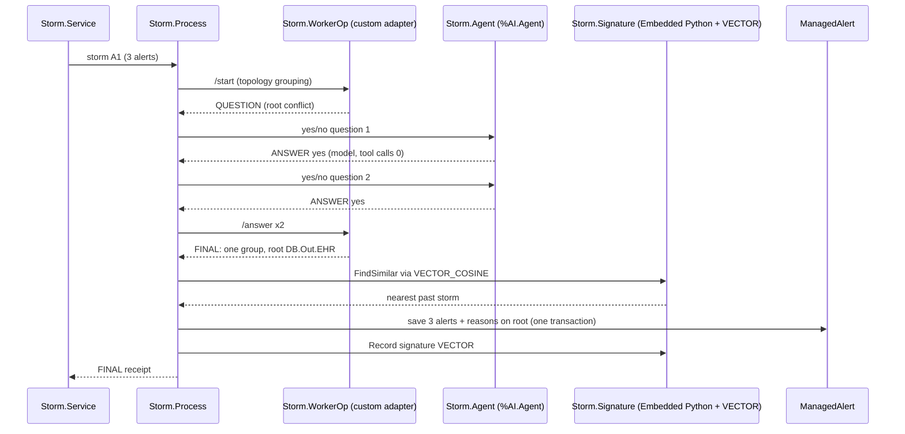

# Native IRIS features in Storm Link

Every feature below is exercised by `scripts/demo.sh` on IRIS 2026.3.0AI.154 (Community).

| Feature | Where | Why it is the right tool |
|---|---|---|
| Interoperability Production (Business Service → Business Process → Business Operation) | `Storm.DemoProduction`, `Storm.Service`, `Storm.Process`, `Storm.AgentOperation` | Each storm becomes one session, so the whole decision is auditable with the tools operators already use. |
| `%AI.Agent` + `%AI.Provider` (AI Hub) | `Storm.AgentOperation` | The model call is a native agent step inside the Production, not a side script; one bounded yes/no question per call, `MaxIterations=1`, no tools. |
| Visual Trace | Portal → Visual Trace, session per storm | Service → Process → WorkerOp → Process appears as one trace (plus Agent when the graph asks a question); the agent reply body carries `Model`, `ToolCalls`, `DurationMs` (and `Usage` when the live backend reports token counts). |
| Managed Alerts (`Ens.Alerting.ManagedAlert`, `UpdateManagedAlert`) | `Storm.Process` | Every original alert is kept; the root alert receives one action per related alert plus the AI evidence as the action reason, so on-call staff see the cause where they already triage. |
| Transactions + globals for a durable receipt | `^Storm.Receipt`, `TSTART/TCOMMIT` | Alerts, reasons and the final receipt commit together; resubmitting the same storm ID returns the saved receipt with zero new alerts or agent calls. |
| IRIS Workflow (`EnsLib.Workflow`: role, task, worklist) | `Storm.ReviewOperation` (config name and role `Storm.Review`), `Storm.Review`, called from `Storm.Process` | When the gate rejects an AI proposal, one review task goes to the reviewer's Workflow inbox; the action is recorded on the task only, so the stored root cause and grouping stay as saved. One task per storm, also after a restart. |
| `%UnitTest` | `Storm.NativeTests`, entry `Storm.Tests.RunTests()` | 12 methods / 72 assertions on the native path: service status, FINAL workflow, durable receipt, idempotent resubmission. `Storm.WorkflowTests`: 8 methods / 52 assertions for the review task. |
| Custom outbound adapter (`Ens.OutboundAdapter`) | `Storm.WorkerAdapter`, used by `Storm.WorkerOperation` in `Storm.DemoProduction` | Isolates the private worker HTTP contract behind a Production adapter; Business Process calls WorkerOp, not raw `%Net.HttpRequest`. |
| Embedded Python (`Language = python`) | `Storm.Signature.Embed`, `Storm.Signature.FindSimilar` (`import iris`) | Builds the storm signature next to the data; FindSimilar drives VECTOR SQL through the IRIS Python module. |
| IRIS Vector Search (`VECTOR`, `TO_VECTOR`, `VECTOR_COSINE`) | Table `Storm_Signature`, written from `Storm.Process` after FINAL | Stores each settled storm and retrieves the nearest past storm for the root Managed Alert reason. |

## Evidence (compose smoke run)

- Visual Trace of storm A1: [img/visual-trace-A1.png](img/visual-trace-A1.png)
- Agent step body with model/tool-call/duration fields: [img/agent-step-A1.png](img/agent-step-A1.png)
- Root Managed Alert with AI evidence in its action reason: [img/managed-alert-A1-root.png](img/managed-alert-A1-root.png)
- Message and alert export for sessions C01/A1: [trace-A1-C01.txt](trace-A1-C01.txt)
- Native test output: [native-test-run.txt](native-test-run.txt)

